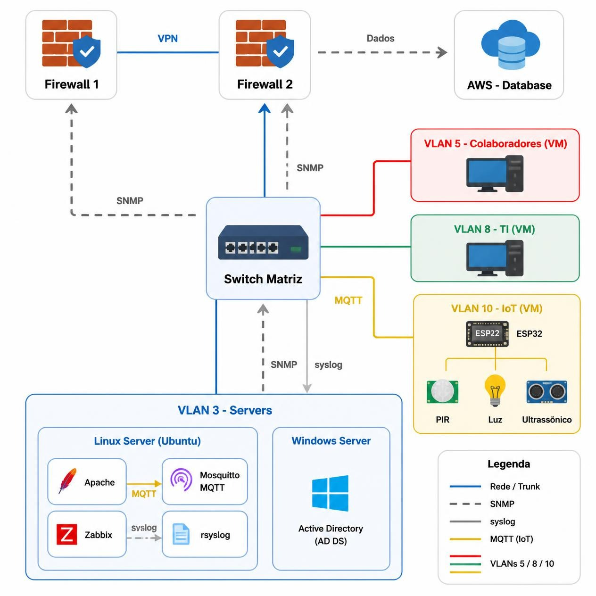

<h1>Projeto Rede de Dados – Tutoria 2026</h1>

<p align="center">
  
  
  
  
  
  
  
</p>

> Status do projeto: :warning: em desenvolvimento (documentação atualizada em 11/11/2026)

<details open>
<summary><strong>SUMÁRIO</strong></summary>

:small_blue_diamond: [Descrição do projeto](#descrição-do-projeto)

:small_blue_diamond: [Arquitetura da solução](#arquitetura-da-solução)

:small_blue_diamond: [Endereçamento da rede](#endereçamento-da-rede)

:small_blue_diamond: [Servidor físico e ESXi](#servidor-físico-e-esxi)

:small_blue_diamond: [Active Directory](#active-directory)

:small_blue_diamond: [SRV-LINUX: serviços](#srv-linux-serviços)

:small_blue_diamond: [Monitoramento com o Zabbix](#monitoramento-com-o-zabbix)

:small_blue_diamond: [IoT emulado e fluxo dos dados](#iot-emulado-e-fluxo-dos-dados)

:small_blue_diamond: [Aplicação e controle de acesso](#aplicação-e-controle-de-acesso)

:small_blue_diamond: [Configuração do switch da matriz](#configuração-do-switch-da-matriz)

:small_blue_diamond: [Configuração do switch da filial](#configuração-do-switch-da-filial)

:small_blue_diamond: [Configuração dos firewalls](#configuração-dos-firewalls)

:small_blue_diamond: [VPNs e redundância em anel](#vpns-e-redundância-em-anel)

:small_blue_diamond: [Testes realizados](#testes-realizados)

:small_blue_diamond: [Segurança e limitações](#segurança-e-limitações)

:small_blue_diamond: [Diferenças entre laboratório e produção](#diferenças-entre-laboratório-e-produção)

:small_blue_diamond: [Pendências](#pendências)

</details>

## Descrição do projeto

<p align="justify">
  Projeto desenvolvido na Tutoria 2026, em parceria entre SENAI e CTI, com foco em simular um ambiente corporativo completo composto por matriz, filial e nuvem. A solução aplica conceitos de redes, segurança, monitoramento e IoT em um contexto real.
</p>

O projeto demonstra como uma organização pode:

- segmentar a rede em VLANs por função
- controlar acesso por firewalls
- conectar escritórios por VPNs seguras
- manter redundância para continuidade do serviço
- isolar e monitorar dispositivos IoT, com alertas de acesso indevido
- integrar uma aplicação corporativa de cadastro de clientes com banco de dados em nuvem
- centralizar logs e monitoramento

## Arquitetura da solução

> Topologia inicial de requisição do projeto.

<p align="center">
  
</p> 

> Diagrama do protótipo 1.2 - Matriz.

<p align="center">
  
</p>

### Componentes da topologia

| Local | Componentes | Detalhes |
| --- | --- | --- |
| Matriz | FortiGate 40F, switch Cisco WS-C2960S-24TD-L, servidor Dell PowerEdge T440 com ESXi (Active Directory, servidor Linux e dispositivo IoT emulado), PCs de colaboradores e TI | Rede principal da empresa e acesso à nuvem |
| Meio | FortiGate-VM | Intermedeia os túneis entre matriz e filial |
| Filial | Firewall, switch Cisco Catalyst 2960-S, PCs (3 usuários), dispositivo IoT | Escritório local, com comunicação segura com a matriz |
| Nuvem | Banco de dados em AWS (VPC) | Infraestrutura centralizada para dados |

## Endereçamento da rede

### Rede matriz

| Elemento | Endereço |
| --- | --- |
| VLAN 3 - Servidores | 10.0.3.0/24 (gateway 10.0.3.1 no firewall) |
| VLAN 5 - Colaboradores | 10.0.5.0/24 |
| VLAN 8 - TI | 10.0.8.0/24 |
| VLAN 10 - IoT | 10.0.10.0/24 (gateway 10.0.10.1 no firewall) |
| Firewall da matriz | 192.168.100.10 |

### Rede filial

| Elemento | Endereço |
| --- | --- |
| VLAN 10 - IoT | 10.1.10.0/24 |
| PCs | 10.1.5.0/24 |
| Firewall da filial | 192.168.100.20 |

### Interconexão e nuvem

| Elemento | Endereço |
| --- | --- |
| Firewall do meio | 192.168.100.1 |
| Banco de dados / VPC | 10.1.1.0/24 |
| Túnel filial ↔ meio | 172.31.0.0/30 |
| Túnel meio ↔ matriz | 172.31.0.12/30 (proposta, depende de aprovação do grupo) |
| Túneis matriz ↔ nuvem | 169.254.10.0/30 e 169.254.10.4/30 |
| Túneis filial ↔ nuvem | 169.254.11.0/30 e 169.254.11.4/30 |

A faixa 172.31.0.12/30 foi proposta porque a tabela original previa uma só faixa para o trecho matriz–filial e agora são dois túneis. As faixas 169.254.x.x vêm do desenho original, por causa da AWS.

### Máquinas no ar

| Máquina | IP | Rede |
| --- | --- | --- |
| SRV-WIN (Active Directory) | 10.0.3.10 | VLAN 3 |
| SRV-LINUX | 10.0.3.20 | VLAN 3 |
| IoT (iot-matriz) | 10.0.10.10 | VLAN 10 |
| ESXi (gerência) | 172.16.31.38 | Rede física da escola |
| iDRAC do servidor | 172.16.9.4 | Rede física da escola |

O DNS dos usuários para `neoxgate.lab` fica no Kali, e o AD responde apenas pela zona `ad.neoxgate.lab`.

## Servidor físico e ESXi

Os três servidores do projeto rodam como VMs em um Dell PowerEdge T440 com VMware ESXi 8.0 U3e, com disco em RAID 0 (sem redundância).

| Item | Valor |
| --- | --- |
| Processador | 8 CPUs, Intel Xeon Bronze 3106 a 1,70 GHz |
| Memória | 15,56 GB |
| Armazenamento | datastore1, 150,75 GB |
| Instalação | Pela iDRAC, com a ISO montada como mídia virtual (sem pendrive) |

**Rede do servidor** (duas portas, cada uma em um vSwitch):

| Placa | vSwitch | Destino |
| --- | --- | --- |
| vmnic0 | vSwitch0 (Management Network e VM Network) | Rede da escola: acesso ao ESXi e internet temporária das VMs |
| vmnic1 | vSwitch-lab | Switch Cisco da matriz, porta Gi4/0/2 (trunk) |

O vSwitch-lab tem dois port groups: `Vlan3-SRV` (ID 0, a VLAN 3 chega sem tag como nativa) e `Vlan10-iot` (ID 10, com tag).

**Máquinas virtuais**

| VM | Sistema | Recursos | Rede |
| --- | --- | --- | --- |
| SRV-Windows25 - NeoxGate | Windows Server 2025 | 2 vCPU, 6 GB, disco de 90 GB em Thin (cerca de 28 GB usados) | Vlan3-SRV e VM Network (placa temporária) |
| SRV-LINUX - NeoxGate | Debian 12 | 2 GB | Vlan3-SRV e VM Network (placa temporária) |
| IoT - NeoxGate | Debian 12 | 2 vCPU, 2 GB, disco de 8 GB | Vlan10-iot e VM Network (placa temporária) |

A VM DOCKER-TOMCAT visível no ESXi pertence a outro grupo e não faz parte do projeto.

O disco do Windows foi migrado de Thick para Thin exportando e importando a VM com o `ovftool` (o export pelo navegador estourava o tempo), o que liberou cerca de 65 GB no datastore.

## Active Directory

O Windows Server 2025 (`SRV-WIN`, 10.0.3.10) é o controlador de domínio único de `ad.neoxgate.lab` (NetBIOS `NEOXGATE`) e já tem o servidor Linux ingressado.

- O DNS do domínio roda no próprio SRV-WIN. A zona `ad.neoxgate.lab` contém os registros do domínio, do `srv-win` e do `srv-linux` (10.0.3.20).
- A placa de internet temporária do Windows permanece desativada: o controlador de domínio registraria o IP dela no DNS e os clientes das outras VLANs receberiam o endereço errado.
- O SSH está ativo no SRV-WIN para administração remota.
- O `dcdiag` passa nos testes de conectividade, anúncio, serviços, NetLogon e funções FSMO, e o SYSVOL e o NETLOGON estão compartilhados.
- O SRV-LINUX entrou no domínio com `realm join` e `sssd`. Para isso, o `/etc/resolv.conf` do Linux precisa apontar para 10.0.3.10, pois a placa de internet temporária reescreve esse arquivo a cada reinicialização.
- Hoje qualquer usuário do domínio pode entrar no Linux (`allow-realm-logins`). A restrição ao grupo da TI depende da estrutura de OUs e grupos, ainda pendente.

## SRV-LINUX: serviços

O SRV-LINUX (Debian 12, `srv-linux.ad.neoxgate.lab`, 10.0.3.20) concentra aplicação, banco, MQTT, syslog e monitoramento em um único servidor da VLAN 3.

| Serviço | Função | Porta |
| --- | --- | --- |
| Apache e PHP | Aplicação de cadastro (`/clientes`) e interface do Zabbix (`/zabbix`) | 80 e 443 |
| MariaDB | Banco da aplicação (`appclientes`, usuário próprio) e banco do Zabbix | 3306, só local |
| Mosquitto | Broker MQTT com usuário e senha, sem acesso anônimo | 1883/TCP |
| Ponte `mqtt2zabbix` | Serviço systemd que lê o Mosquitto e entrega os valores ao Zabbix | - |
| Zabbix server | Armazena os dados, avalia triggers e gera alertas | 10051/TCP |
| Zabbix Agent 2 | Monitora o próprio servidor e lê arquivos de log | 10050/TCP |
| rsyslog | Syslog central: recebe os logs dos outros equipamentos | 514/UDP e TCP |
| dnsmasq | DNS local com os nomes do laboratório (hoje o DNS dos usuários é o do Kali) | 53 |
| Grafana | Instalado com o plugin do Zabbix, ainda sem painéis | 3000/TCP |

**Mosquitto.** Dois usuários com permissões separadas: `iot_sensor`, que só publica em `sensores/#`, e `zbx_bridge`, que só lê esse tópico. As mensagens seguem o tópico `sensores/<local>/leitura`, com um JSON de `local`, `pir`, `ldr`, `dist` e `alarme`.

**Syslog.** Um arquivo por equipamento e por programa em `/var/log/remoto/<host>/<programa>.log`, com rotação diária de 14 arquivos compactados.

## Monitoramento com o Zabbix

O Zabbix 7.0 monitora o dispositivo IoT e os serviços do próprio servidor, e abre um alerta quando um sensor dispara ou um serviço cai. O nome do host `Zabbix server` é igual ao Hostname do agente, porque os itens de log (agente ativo) só funcionam quando os dois coincidem.

| Host | Itens |
| --- | --- |
| IOT-MATRIZ (grupo IoT) | Quatro itens do tipo trapper: `sensor.pir`, `sensor.ldr`, `sensor.dist` e `sensor.alarme` |
| Zabbix server (o próprio SRV-LINUX) | Portas 514/UDP, 1883/TCP e 80/TCP, o processo da ponte e quatro itens de log: alarmes do IoT, 403 do Apache, erros do Apache e falhas de login SSH |

| Trigger | Host | Gravidade | Condição |
| --- | --- | --- | --- |
| Alarme ativo | IOT-MATRIZ | Average | `sensor.alarme` igual a 1 |
| Movimento fora do expediente | IOT-MATRIZ | High | PIR igual a 1 antes das 8h ou depois das 18h |
| Presença próxima fora do expediente | IOT-MATRIZ | High | Distância menor que 30 cm fora do expediente |
| Luz acesa fora do expediente | IOT-MATRIZ | High | LDR maior que 2000 fora do expediente |
| Sensor sem dados | IOT-MATRIZ | High | Nenhum valor de PIR em 2 minutos |
| Syslog, Mosquitto, Apache e ponte parados | Zabbix server | High | Porta ou processo igual a 0 |

Dois dashboards foram criados pela API do Zabbix, com um script que pode ser executado de novo:

- **IoT - Matriz:** alarme e PIR (vermelhos quando valem 1), medidores de luz e distância, disponibilidade, problemas do grupo IoT e o último alarme vindo do syslog.
- **Infraestrutura:** estado do syslog, do Mosquitto e do Apache, relógio, informações do Zabbix, problemas, acessos bloqueados (403) e falhas de SSH.

## IoT emulado e fluxo dos dados

O dispositivo IoT é emulado em uma VM Debian 12 sem interface gráfica (`iot-matriz`, 10.0.10.10, VLAN 10). O script `/opt/iot/emulador.sh` envia por MQTT, a cada 5 segundos, leituras de movimento (PIR), luz (LDR) e distância, que o Zabbix transforma em alertas. Se houver movimento, luz acima de 2000 ou presença a menos de 30 cm, o alarme sobe para 1. A senha do MQTT é pedida na hora, sem ficar gravada.

| Cenário | Efeito |
| --- | --- |
| `normal` | Tudo em repouso, `alarme` igual a 0 |
| `movimento` | `pir` igual a 1 e `alarme` igual a 1 |
| `luz` | `ldr` alto e `alarme` igual a 1 |
| `presenca` | Distância abaixo de 30 cm e `alarme` igual a 1 |

O dado segue dois caminhos independentes, e o emulador nunca fala direto com o Zabbix:

```text
VLAN 10 · IoT (10.0.10.10)                     VLAN 3 · SRV-LINUX (10.0.3.20)

Emulador (bash) ──── 1883/TCP ───────────────► Mosquitto ──► Ponte mqtt2zabbix
 leituras a cada 5 s                                              │ 10051/TCP
      │ linha ALARME                                              ▼
      ▼                                                     Zabbix server
rsyslog do IoT ───── 514/UDP ───► rsyslog do servidor ────► (valores e logs)
```

Os dados dos sensores vão ao Mosquitto e à ponte, os logs vão pelo rsyslog, e o Zabbix recebe os dois.

## Aplicação e controle de acesso

A aplicação de cadastro de clientes roda no Apache em `/clientes` e só aceita acessos das VLANs 5 e 8; a VLAN 3 recebe `403 Forbidden`, como o briefing pede. O controle fica no arquivo `appclientes.conf` do Apache, com `Require ip` para as VLANs 5 e 8 e para o próprio servidor.

- O banco `appclientes` usa um usuário próprio do MariaDB e hoje é **local**; a migração para a nuvem está pendente.
- A aplicação não tem login, então os logs do Apache registram só o IP de origem, e não quem acessou. Essa limitação, com o impacto na LGPD, deve constar na entrega.
- O print do 403 foi tirado a partir do SRV-WIN (VLAN 3). Para demonstrar a aplicação funcionando, o acesso precisa vir de uma máquina das VLANs 5 ou 8.

## Configuração do switch da matriz

O switch **SW-MATRIZ** (Cisco WS-C2960S-24TD-L) tem as VLANs 3, 5, 8 e 10 criadas e substitui o switch virtual em Open vSwitch usado no protótipo.

| Porta | Função | Configuração |
| --- | --- | --- |
| Gi4/0/1 | Uplink do firewall da matriz | Trunk, VLANs 3, 5, 8 e 10 |
| Gi4/0/2 | Servidor ESXi | Trunk, VLAN 3 nativa, VLANs 3 e 10 permitidas |
| Gi4/0/3 | Colaboradores | Acesso, VLAN 5 |
| Gi4/0/4 | TI | Acesso, VLAN 8 |
| Gi4/0/5 | IoT físico | Acesso, VLAN 10 |

O switch separa o tráfego por função: VLAN 3 (servidores), VLAN 5 (colaboradores), VLAN 8 (TI) e VLAN 10 (IoT).

## Configuração do switch da filial

O acesso da filial utiliza um switch Cisco Catalyst 2960-S. A configuração inicial já foi aplicada, mas é **provisória**: as conexões e as VLANs ainda precisam ser validadas antes de o equipamento ser considerado pronto para uso.

| Item | Valor |
| --- | --- |
| Marca / Modelo | Cisco Catalyst 2960-S |
| Hostname | SW-FILIAL-CTI |
| Acesso de gerência | Console, com usuário local `admin` |
| Status | Configuração inicial provisória |

### O que foi configurado

| Item | Configuração |
| --- | --- |
| Identificação | Hostname `SW-FILIAL-CTI` |
| Acesso privilegiado | Senha de enable definida |
| Autenticação | Usuário local `admin` e login local no console |
| Senhas | Criptografia de senhas ativada na configuração |
| Banner | Banner de acesso restrito |
| Console | Timeout de inatividade de 5 minutos |
| VLAN | VLAN 10 criada com o nome `IOT2`, ainda sem portas atribuídas |

### Portas

| Portas | Estado | Observação |
| --- | --- | --- |
| Gi1/0/1 a Gi1/0/5 | Disponíveis | Função de cada porta ainda a definir |
| Gi1/0/6 a Gi1/0/48 | Desativadas (`shutdown`) | Portas não utilizadas |
| Te1/0/1 e Te1/0/2 | Sem alteração | Portas de 10 Gb |
| Fa0 | Sem alteração | Porta de gerenciamento |

As portas não utilizadas permanecem desativadas administrativamente para reduzir a superfície de acesso à rede.

## Configuração dos firewalls

### Regras de acesso entre redes (briefing)

- **VLAN 5 (colaboradores):** acessa as aplicações dos servidores.
- **VLAN 8 (TI):** acessa os servidores por portas pré-definidas e os equipamentos dos colaboradores.
- **VLAN 10 (IoT):** rede apartada, alcança apenas o necessário para o monitoramento.
- PCs da matriz e da filial não se acessam.
- Para as VLANs 5 e 8 entrarem no domínio, o firewall também precisa liberar até 10.0.3.10 as portas do AD (DNS, Kerberos, LDAP, SMB, RPC e tempo).

### Firewall da matriz

| Item | Valor |
| --- | --- |
| Marca / Modelo | Fortinet FortiGate 40F |
| Sistema operacional | FortiOS 7.4.12 (build 2902) |
| Nome do VDOM | FGT-VDOM-MTZ-SENAI |
| IP de gerência (projeto) | 192.168.100.10 |

**Interfaces (coletadas em 10/11/2026)**

| Interface | Função | Endereço | Estado |
| --- | --- | --- | --- |
| lan1 | LAN | 192.168.200.10/24 | up |
| lan2 | WAN | 172.16.31.30/24 (DHCP) | up |
| a | - | 172.23.45.1/24 | down |

**Políticas de firewall**

| ID | Nome | Origem → destino | Serviços |
| --- | --- | --- | --- |
| 1 e 2 | Regras do VDOM Link (não editar) | any ↔ Root-T21 | ALL |
| 3 | Saida Internet Matriz | lan1 → lan2 | ALL |
| 4 | COLAB-para-SRVapps | VLAN 5 → VLAN 3 | HTTP, HTTPS, PING |
| 5 | TI-para-SRV-portas | VLAN 8 → VLAN 3 | SSH, RDP, HTTP, HTTPS, PING |
| 6 | TI-para-COLAB | VLAN 8 → VLAN 5 | ALL |
| 7 | TI-para-IOT | VLAN 8 → VLAN 10 | ALL |
| 8 | COLAB-para-Internet | VLAN 5 → lan2 | HTTP, HTTPS, DNS, PING |
| 9 | TI-para-Internet | VLAN 8 → lan2 | ALL |
| 10 | SRV-para-Internet | VLAN 3 → lan2 | DNS, HTTP, HTTPS, PING |
| 11 | COLAB-TI-DNS-paraSRV | VLAN 5 e VLAN 8 → 10.0.3.20 | DNS |
| 12 | SRV-para-IOT | 10.0.3.20 e 10.0.3.10 → 10.0.10.10 | PING, HTTP, HTTPS |
| 13 | IOT-para-SRV-monitor | 10.0.10.10 → 10.0.3.20 | PING, MQTT-IOT, SYSLOG-UDP-514, SYSLOG-TCP-514 |

A política 13 libera o monitoramento do IoT e continua restrita a esse par de hosts. O serviço SYSLOG padrão cobre só UDP 514, e o RSH não serve para syslog TCP; por isso foram criados os serviços próprios `SYSLOG-UDP-514` e `SYSLOG-TCP-514`. Verificação: `diagnose debug flow` filtrado por origem 10.0.10.10, destino 10.0.3.20 e porta 514 deve mostrar `Allowed by Policy-13`. Se o firewall libera e o servidor não recebe, confira no SRV-LINUX se o rsyslog escuta em 514 (`ss -lntu | grep 514`) e se o firewall do próprio servidor libera a porta.

Nenhuma dessas políticas usa a interface `VPN-MTZ-MEIO`: sem políticas entre servidores/IoT da matriz e o IoT da filial, o túnel pode subir, mas nenhum tráfego passa por ele (ver [Pendências](#pendências)).

**Verificação de conectividade** (CLI, registrada em 21/10/2026, com a WAN em 172.16.33.35/24):

| Teste | Resultado |
| --- | --- |
| Ping para o gateway da WAN | Sucesso |
| Ping para 8.8.8.8 | Sucesso |
| Ping para google.com | Falha na resolução de nome |

A conectividade IP com a internet funcionava; a falha de resolução indica problema de DNS ainda não confirmado, pois a configuração não pôde ser lida pelo CLI. A rota padrão registrada então usava o gateway 172.16.33.254, fora da rede 172.16.31.0/24 atual, o que sugere que o endereço mudou. A conferência deve ser refeita com `get router info routing-table all` e `execute ping 8.8.8.8`.

### Firewall do meio

| Item | Valor |
| --- | --- |
| Modelo | FortiGate-VM (sem VDOM) |
| port1 (WAN) | 172.16.31.43/24 (DHCP), up |
| port2 | Sem IP, up |
| Criptografia disponível | Apenas DES e NULL (ver [Diferenças entre laboratório e produção](#diferenças-entre-laboratório-e-produção)) |

O meio decide quem passa para onde. Políticas provisórias entre servidores e IoT (`MTZ-para-FIL-IoT` e `FIL-IoT-para-MTZ`) usam a port1 como saída até o túnel da filial existir; depois a interface passa a ser `VPN-MEIO-FIL`.

### Firewall da filial

| Item | Valor |
| --- | --- |
| Modelo | FortiGate (a confirmar) |
| Nome do VDOM | FGT-VDOM-FILIAL-SENAI (VDOM NEOXGATE) |
| IP de gerência (projeto) | 192.168.100.20 |
| lan1 | 192.168.200.1/24, secundário 10.1.5.1/24, up |
| lan2 (WAN) | DHCP, 0.0.0.0, down |
| a | 172.16.23.1/24, down |

Funções previstas: controle de acesso à internet e à nuvem, navegação encaminhada pela matriz (atravessa o meio e sai pela lan2 da matriz com NAT, em etapa posterior), bloqueio entre PCs da filial e da matriz e terminação das VPNs.

## VPNs e redundância em anel

O diagrama do projeto prevê duas VPNs da filial e da matriz passando pelo firewall do meio, e o anel fecha em filial → meio → matriz → nuvem → filial. O túnel direto matriz–filial montado no início foi substituído por dois túneis; objetos, políticas e o isolamento dos PCs continuam valendo.

| Túnel | Origem | Destino | Finalidade | Faixa |
| --- | --- | --- | --- | --- |
| VPN-FIL-MEIO | Filial (lan2) | Meio (port1) | Comunicação entre escritórios | 172.31.0.0/30 (meio .1, filial .2) |
| VPN-MTZ-MEIO | Matriz (lan2) | Meio (port1) | Comunicação entre escritórios | 172.31.0.12/30 (meio .13, matriz .14) |
| Matriz ↔ Nuvem | Matriz | AWS | Acesso ao banco de dados | 169.254.10.0/30 e 169.254.10.4/30 |
| Filial ↔ Nuvem | Filial | AWS | Acesso ao banco de dados | 169.254.11.0/30 e 169.254.11.4/30 |

Todos são IPsec site-to-site (IKEv2). Matriz e filial só se alcançam pelo meio, e a nuvem fecha o anel. Em caso de falha de um link, a comunicação segue pelo caminho restante.

| Item | Valor |
| --- | --- |
| Protocolo de roteamento / failover | OSPF / roteamento dinâmico com redundância em anel |
| Tempo de convergência | A definir |

### Estado em 10/11/2026

| Item | Estado | O que falta |
| --- | --- | --- |
| Rede matriz ↔ meio (172.16.31.0/24) | Ping responde nos dois sentidos | Nada |
| VPN-MTZ-MEIO | Matriz em `connecting`; o meio recebe o `IKE_SA_INIT` e o descarta com `no policy configured` | Aplicar a interface do túnel e as políticas no meio e testar |
| Proposal IKE e IPsec | `des-sha256`, DH 14, nos dois lados | Em produção, voltar a `aes256-sha256` |
| Syslog 514 UDP/TCP (IoT → servidor) | Liberado na política 13 da matriz e validado | Nada |
| Filial | lan1 up em 192.168.200.1/24; lan2 down, sem IP; o Kali não resolve ARP da lan1 | Link e IP da lan2, depois o túnel VPN-FIL-MEIO |
| Túneis com a nuvem (AWS) | Faixas definidas no desenho original | Sem configuração registrada |

### Configuração da matriz (VPN-MTZ-MEIO)

```bash
config vpn ipsec phase1-interface
edit "VPN-MTZ-MEIO"
set interface "lan2"
set ike-version 2
set peertype any
set net-device disable
set proposal des-sha256
set dhgrp 14
set remote-gw 172.16.31.43
set psksecret <SENHA-FORTE-1>
set dpd on-idle
set dpd-retrycount 3
set dpd-retryinterval 10
next
end

config vpn ipsec phase2-interface
edit "VPN-MTZ-MEIO"
set phase1name "VPN-MTZ-MEIO"
set proposal des-sha256
set dhgrp 14
set auto-negotiate enable
next
end

config system interface
edit "VPN-MTZ-MEIO"
set ip 172.31.0.14 255.255.255.255
set remote-ip 172.31.0.13 255.255.255.252
set allowaccess ping
next
end

config router static
edit 0
set dst 10.1.5.0 255.255.255.0
set device "VPN-MTZ-MEIO"
set comment "PCs filial via meio"
next
edit 0
set dst 10.1.10.0 255.255.255.0
set device "VPN-MTZ-MEIO"
set comment "IoT filial via meio"
next
end
```

A senha pré-compartilhada deve ser forte, igual nas duas pontas e nunca colada em chat ou repositório.

### Configuração do meio (VPN-MEIO-MTZ)

```bash
config vpn ipsec phase1-interface
edit "VPN-MEIO-MTZ"
set interface "port1"
set ike-version 2
set peertype any
set net-device disable
set proposal des-sha256
set dhgrp 14
set remote-gw 172.16.31.30
set dpd on-idle
set dpd-retrycount 3
set dpd-retryinterval 10
next
end

config vpn ipsec phase2-interface
edit "VPN-MEIO-MTZ"
set phase1name "VPN-MEIO-MTZ"
set proposal des-sha256
set dhgrp 14
set auto-negotiate enable
next
end

config system interface
edit "VPN-MEIO-MTZ"
set ip 172.31.0.13 255.255.255.255
set remote-ip 172.31.0.14 255.255.255.252
set allowaccess ping
next
end

config router static
edit 0
set dst 10.0.3.0 255.255.255.0
set device "VPN-MEIO-MTZ"
set comment "Servidores matriz"
next
edit 0
set dst 10.0.10.0 255.255.255.0
set device "VPN-MEIO-MTZ"
set comment "IoT matriz"
next
end

config firewall address
edit "SRV-MATRIZ"
set subnet 10.0.3.0 255.255.255.0
next
edit "IOT-MATRIZ"
set subnet 10.0.10.0 255.255.255.0
next
edit "IOT-FILIAL"
set subnet 10.1.10.0 255.255.255.0
next
end

config firewall policy
edit 0
set name "MTZ-para-FIL-IoT"
set srcintf "VPN-MEIO-MTZ"
set dstintf "port1"
set srcaddr "SRV-MATRIZ" "IOT-MATRIZ"
set dstaddr "IOT-FILIAL"
set action accept
set schedule "always"
set service "ALL"
next
edit 0
set name "FIL-IoT-para-MTZ"
set srcintf "port1"
set dstintf "VPN-MEIO-MTZ"
set srcaddr "IOT-FILIAL"
set dstaddr "SRV-MATRIZ" "IOT-MATRIZ"
set action accept
set schedule "always"
set service "ALL"
next
end
```

O phase1 e o phase2 foram verificados com `show full-configuration` e estão corretos. O resultado da aplicação da interface do túnel e das rotas ainda não foi confirmado.

### Diagnóstico do túnel Matriz–Meio (10/11/2026)

O meio recebe o pedido IKE da matriz e o descarta com `no policy configured`; rede, proposal e configuração do túnel foram descartados como causa.

| Hora | Teste | Resultado | Conclusão |
| --- | --- | --- | --- |
| 16:26 | `diagnose vpn ike gateway list` e ping ao túnel | `connecting`, SPI do responder zerado; 100% de perda | A matriz envia o `IKE_SA_INIT` e não recebe resposta |
| 16:29 | Ping pela WAN; phase1 do meio | Pings responderam; meio com `des-md5 des-sha1` | Rede OK; proposals diferentes |
| 16:31 | phase2 do meio | Também `des-md5 des-sha1` | Phase2 divergente |
| 16:32 | `set proposal aes256-sha256` no meio | `command parse error`, código -61 | O meio rejeita AES |
| 16:34 | `set proposal ?` no meio | Só `null-*` e `des-*` | Só criptografia fraca disponível |
| 16:38 | `des-sha256` nos dois lados, `clear` do gateway | Aplicado sem erro; túnel não sobe | Túnel ainda não sobe |
| 16:40 | `gateway list` na matriz | `connecting`, SPI zerado | Sem resposta do meio |
| 16:41 | Sniffer na port1 do meio, UDP 500 | Pacotes de 436 bytes da matriz chegam e se repetem; sem resposta | Rede e UDP 500 OK; o meio não responde |
| 16:42 | `diagnose debug application ike -1` no meio | `ignoring IKEv2 request, no policy configured`; proposta recebida: DES_CBC, SHA2_256, MODP2048 | O meio rejeita antes de comparar algoritmo ou senha |
| 16:43 | `show full-configuration` do phase2 | Correto: `des-sha256`, DH 14, seletores 0.0.0.0/0, auto-negotiate | Registro não está corrompido |
| 16:45 | `show full-configuration` do phase1 | Correto: `des-sha256`, `remote-gw 172.16.31.30`, `port1` | Configuração do túnel está certa |

**Causa mais provável (não confirmada):** em FortiGates recentes, o IKE de um túnel de interface parece ignorar o pedido quando nenhuma política de firewall referencia a interface, e o meio ainda não tinha política com `VPN-MEIO-MTZ`. O teste é aplicar a interface do túnel e as políticas e rodar na matriz:

```bash
diagnose vpn ike gateway clear name VPN-MTZ-MEIO
diagnose vpn ike gateway list
```

O esperado é `status: established`, seguido de ping em 172.31.0.13 (da matriz) e 172.31.0.14 (do meio). Se continuar igual:

1. Coletar `get system status` do meio e verificar `License Status` e `VM Resource` (a VM de avaliação oferecer só DES/NULL sugere limitação de licença, ainda não verificada).
2. Testar `set pfs disable` no phase2 do meio (hipótese menos provável).
3. Trocar o meio por um pfSense, configurável pela tela e sem dependência de licença.

A senha pré-compartilhada do meio aparece criptografada e não pode ser comparada visualmente. Se o túnel subir e falhar na autenticação, redefina `psksecret` nas duas pontas.

### Filial: situação e próximos passos

A filial ainda não tem túnel porque a lan2 está sem link e sem IP, e o acesso pelo Kali (eth0 192.168.200.50/24, VirtualBox) à lan1 falha na camada 2: nenhum dos dois lados resolve o ARP do outro, o que indica problema de cabo, porta ou adaptador da VM, e não de regra de firewall. A configuração da filial não depende do Kali, pois os blocos de CLI podem ser colados pelo console (COM4).

**Verificações recomendadas para o acesso pelo Kali, em ordem:**

1. No firewall: `diagnose sniffer packet lan1 'arp or icmp' 4 10` enquanto o Kali pinga. Se o `who-has` não aparece, o Kali não está na mesma rede física da lan1.
2. No Kali: `ip neigh show` e ping para 192.168.200.10 (lan1 da matriz).
3. No VirtualBox: Adaptador 1 em modo bridge, na placa Ethernet física ligada ao firewall (não o Wi-Fi), com "Cabo conectado" e modo promíscuo em "Permitir tudo".
4. Cabo direto entre o notebook e a lan1, se houver switch no caminho.

**WAN da filial (lan2).** O grupo informou que ela não vai pegar IP por DHCP. Alternativas levantadas:

| Opção | Como | Condição |
| --- | --- | --- |
| IP fixo na 172.16.31.0/24 | `set mode static`, `set ip 172.16.31.<LIVRE> 255.255.255.0`, `set allowaccess ping` | A CTI confirmar um IP livre |
| Liberar o MAC no DHCP | Pedir à CTI para liberar o MAC da lan2 da filial | Rede do SENAI/CTI filtrar por MAC |
| Cabo direto filial ↔ meio | port2 do meio 172.16.40.1/30 e lan2 da filial 172.16.40.2/30, usados como `remote-gw` | O diagrama do projeto permitir esse cabo |

**Modelo do túnel da filial** (ainda não aplicado):

```bash
config vpn ipsec phase1-interface
edit "VPN-FIL-MEIO"
set interface "lan2"
set ike-version 2
set peertype any
set net-device disable
set proposal des-sha256
set dhgrp 14
set remote-gw 172.16.31.43
set psksecret <SENHA-FORTE-2>
set dpd on-idle
next
end

config system interface
edit "VPN-FIL-MEIO"
set ip 172.31.0.2 255.255.255.255
set remote-ip 172.31.0.1 255.255.255.252
set allowaccess ping
next
end
```

O phase2 segue o da matriz, trocando o nome. As rotas da filial vão para 10.0.3.0/24 e 10.0.10.0/24 pelo túnel. O `remote-gw` e a interface mudam se a opção do cabo direto for escolhida.

## Testes realizados

Executados no ambiente, todos com resultado positivo.

| Teste | Evidência |
| --- | --- |
| Saúde do AD | `dcdiag` nos testes de conectividade, anúncio, NetLogons, serviços e FSMO; SYSVOL e NETLOGON compartilhados |
| DNS do AD | `nslookup ad.neoxgate.lab` devolve só 10.0.3.10 |
| Ingresso do Linux no domínio | `realm list` com `kerberos-member` e `Get-ADComputer` listando SRV-LINUX |
| Mosquitto recusa acesso anônimo | `Connection Refused: not authorised` a partir do IoT, pela VLAN 10 |
| Sensores até o Zabbix | Último valor no Zabbix com 3 segundos de atraso em relação ao horário do servidor |
| Alarme no Zabbix | Cenário `movimento` coloca PIR e alarme em 1 e abre o problema "Alarme ativo"; o cenário `normal` resolve |
| Gateway da VLAN 10 | `ping 10.0.10.1` responde em cerca de 0,2 ms |
| Syslog do IoT no servidor | Linhas do IoT chegam ao SRV-LINUX depois da liberação da 514/UDP |
| Controle de acesso da aplicação | O SRV-WIN, na VLAN 3, recebe 403 Forbidden em `/clientes` |
| Migração do Windows para Thin | Hash SHA256 do disco igual ao do manifesto; VM importada com o AD funcionando |
| Rede matriz ↔ meio | Ping nos dois sentidos pela WAN (172.16.31.0/24) |

Os servidores dependem do switch Cisco e do firewall da matriz. O IoT alcança o servidor pela VLAN 10 nas seguintes liberações, da VLAN 10 para o SRV-LINUX:

| Origem | Destino | Porta | Para quê |
| --- | --- | --- | --- |
| 10.0.10.10 | 10.0.3.20 | 1883/TCP | Leituras dos sensores (MQTT) |
| 10.0.10.10 | 10.0.3.20 | 514/UDP | Logs do IoT (syslog) |

O Zabbix recebe valores e linhas de log na porta 10051 (ponte e agente → Zabbix server), dentro do próprio servidor.

## Segurança e limitações

**Já aplicado**

- Mosquitto sem acesso anônimo, com permissões separadas para o sensor (só publica) e para a ponte (só lê).
- Credenciais da ponte em arquivo com permissão restrita, fora do script.
- Aplicação liberada só para as VLANs 5 e 8.
- IoT em VLAN própria, alcançando o servidor só nas portas 1883/TCP e 514/UDP (mais PING).
- Nenhuma política liga os PCs da matriz aos PCs da filial; só servidores e IoT atravessam os túneis.

**Antes da entrega**

- Trocar todas as senhas de teste: MariaDB do Zabbix, Mosquitto (`iot_sensor` e `zbx_bridge`), Admin do Zabbix, admin do Grafana, SSH e contas das VMs.
- Revogar o token da API do Zabbix usado para criar os dashboards.
- Remover da regra do Apache o IP de teste da rede da escola.
- Desconectar as placas temporárias de internet e conferir com `ip -br a` que o servidor usa só a rede do projeto.
- Desligar o SSH do ESXi e do SRV-WIN, se não forem mais usados, e trocar a senha da iDRAC.
- Colocar senha nas linhas vty do switch Cisco (hoje `login` sem senha) e nunca publicar o `show running-config`, pois contém o hash do enable secret.
- Restringir a interface do Zabbix e a porta 3000 do Grafana à VLAN 8 e ao próprio servidor.
- Nenhuma senha ou token em arquivo versionado nem no repositório.

**Limitações a documentar**

- A senha do MQTT aparece na lista de processos (`ps`) enquanto a ponte e o emulador rodam.
- A aplicação não tem login, e os logs mostram só o IP de origem (impacto na LGPD).
- O acesso ao console do ESXi e ao menu de boot (GRUB) das VMs dá controle total sobre elas; o acesso ao ESXi precisa ser restrito.
- O disco do servidor está em RAID 0, sem redundância: manter cópias das VMs fora do servidor.

## Diferenças entre laboratório e produção

- **Criptografia reduzida.** O FortiGate-VM do meio só oferece DES e NULL, então o túnel usa `des-sha256` com DH 14. Em produção seria `aes256-sha256` com DH 14, como na primeira versão da matriz, com a mesma topologia e as mesmas políticas. A causa exata (licença de avaliação) não foi confirmada com `get system status`.
- **IPs por DHCP.** Os túneis usam `remote-gw` fixo apontando para IPs entregues por DHCP (172.16.31.30 e 172.16.31.43). Se um deles mudar, o túnel cai; a solução é pedir à CTI uma reserva de DHCP.
- **Isolamento.** Nenhuma política liga os PCs da matriz aos da filial. Dentro da matriz, o IoT 10.0.10.10 alcança apenas o servidor 10.0.3.20, e só em PING, MQTT (1883/TCP) e syslog (514 UDP/TCP).
- **Persistência.** No FortiGate cada bloco `set … next … end` já grava na configuração em execução, que sobrevive a reinício; não existe "salvar". Faça backup (Configuration > Backup) antes de mudanças grandes. Reverter um snapshot da VM desfaz o que foi feito depois dele.

### Comandos de verificação

| Objetivo | Comando | Onde |
| --- | --- | --- |
| Ver IPs e link das interfaces | `get system interface physical` | Os três |
| Testar a WAN entre matriz e meio | `execute ping 172.16.31.43` / `execute ping 172.16.31.30` | Matriz / meio |
| Estado do túnel IKE | `diagnose vpn ike gateway list` | Matriz e meio |
| Reiniciar a negociação | `diagnose vpn ike gateway clear name VPN-MTZ-MEIO` | Matriz |
| Ver se o IKE chega | `diagnose sniffer packet port1 'host 172.16.31.30 and udp port 500' 4 20` | Meio |
| Depurar o IKE | `diagnose debug application ike -1` e `diagnose debug enable`; parar com `diagnose debug disable` e `diagnose debug reset` | Meio |
| Conferir phase1 e phase2 | `show full-configuration vpn ipsec phase1-interface <nome>` e `…phase2-interface <nome>` | Meio |
| Listar proposals aceitos | `set proposal ?` dentro do `edit` | Meio |
| Conferir a interface do túnel | `show system interface VPN-MEIO-MTZ` | Meio |
| Políticas e serviços | `show firewall policy`, `show firewall service custom` | Matriz |
| Seguir um fluxo (syslog) | `diagnose debug flow filter saddr 10.0.10.10`, `daddr 10.0.3.20`, `dport 514`, `diagnose debug flow trace start 20` | Matriz |
| ARP e camada 2 na filial | `get system arp`, `diagnose sniffer packet lan1 'arp or icmp' 4 10` | Filial |
| Licença e versão | `get system status` | Meio |
| Rotas e internet | `get router info routing-table all`, `execute ping 8.8.8.8` | Matriz |

## Pendências

| Item | Frente | Situação |
| --- | --- | --- |
| Aplicar interface do túnel e políticas no meio e confirmar o túnel Matriz–Meio | Firewall | Pendente |
| Criar políticas de servidores/IoT da matriz para a interface `VPN-MTZ-MEIO` | Firewall | Pendente |
| Link e IP da lan2 da filial; montar o túnel VPN-FIL-MEIO | Firewall | Pendente |
| Aprovar a faixa 172.31.0.12/30 (meio ↔ matriz) | Firewall | Pendente |
| Configurar os túneis com a nuvem (AWS) | Firewall | Pendente |
| Verificar a configuração de DNS do FortiGate da matriz e a rota padrão | Firewall | Pendente |
| Definir modelo do firewall da filial | Firewall | Pendente |
| Definir tempo de convergência do anel | Firewall | Pendente |
| Pedir à CTI reserva de DHCP para matriz e meio | Firewall | Pendente |
| Navegação da filial pelo firewall da matriz | Firewall | Pendente |
| Definir função das portas Gi1/0/1 a Gi1/0/5 do switch da filial | Switch | Pendente |
| Definir VLAN dos PCs da filial e separação da rede IoT | Switch | Pendente |
| Configurar o link entre o switch e o firewall da filial | Switch / Firewall | Pendente |
| Decidir sobre acesso remoto por SSH no switch da filial | Switch | Pendente |
| Conferir e salvar a configuração do switch da filial | Switch | Pendente |
| Banco de dados na nuvem (AWS) e aplicação usando esse banco (VPC 10.1.1.0/24) | Servidores | Pendente (hoje o banco é local) |
| Estrutura do AD: OUs, grupos e usuários de TI e colaboradores | Servidores | Pendente (destrava a restrição do login do Linux e do RDP à TI) |
| Acesso remoto ao Windows com SSO e dupla autenticação | Servidores | Pendente (diferencial do briefing) |
| Monitorar o SRV-WIN no Zabbix (agente e template Windows by Zabbix agent) | Servidores | Pendente |
| Monitorar switch e firewall por SNMP | Servidores / Rede | Pendente |
| Painéis do Grafana | Servidores | Opcional |
| DNS único: integrar o AD e o DNS do Kali | Servidores | Pendente (hoje são duas zonas separadas) |
| Serviço systemd para o emulador subir sozinho | Servidores | Pendente (hoje roda à mão) |
| Remover as placas temporárias de internet (SRV-LINUX, SRV-WIN e IoT) | Servidores / Rede | Quando o firewall entregar a saída de internet |
| Teste de reinicialização de todas as VMs e do switch | Servidores | Pendente |
| Filial completa, com IoT e alarme, e host IOT-FILIAL no Zabbix | Rede / Servidores | Pendente (o alarme precisa soar nos dois escritórios) |
| Itens de [Antes da entrega](#segurança-e-limitações) | Todas | Pendente |

## Desenvolvedores/Contribuintes :octocat:

| [<br><sub>Jully Ferrari</sub>](https://github.com/JullySzztiass) | [<br><sub>Vinícius</sub>](https://github.com/Dedenyee) | [<br><sub>Isabelly</sub>](https://github.com/isabellyyvitoria) | [<br><sub>Luane</sub>](https://github.com/gluane) | [<br><sub>Kaua Brito</sub>](https://github.com/kaua-brito) |
| :---: | :---: | :---: | :---: | :---: |
| Documentação | Servidor | Firewall | Firewall | Switch & IoT |


---

## Licença

The [MIT License]() (MIT)

Copyright :copyright: 2026 - Projeto Rede de Dados (SENAI e CTI)

> Referência: [Preparação pré-projeto](https://miro.com/app/board/uXjVHhTdmiQ=/?share_link_id=182961988823)
