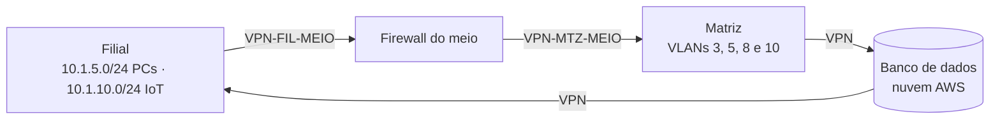

# Projeto Rede de Dados

Projeto final do curso do **SENAI**, desenvolvido em parceria com a **CTI** (Tutoria 2026). O objetivo é reproduzir um ambiente corporativo com matriz, filial e nuvem, cobrindo VLANs, firewalls, VPN em anel, IoT, aplicação com banco na nuvem e monitoramento.

## Visão geral



| VLAN | Uso | Faixa |
|------|-----|-------|
| 3 | Servidores | 10.0.3.0/24 |
| 5 | Colaboradores | 10.0.5.0/24 |
| 8 | TI | 10.0.8.0/24 |
| 10 | IoT | 10.0.10.0/24 |

Endereçamento completo, hosts e túneis em [docs/arquitetura.md](docs/arquitetura.md).

## Status

Conforme a documentação de 10/11/2026 (detalhe por requisito em [docs/requisitos.md](docs/requisitos.md)).

| Frente | Situação |
|--------|----------|
| Servidores da matriz (ESXi, Active Directory, servidor Linux) | Concluído |
| Monitoramento (Zabbix, syslog) e IoT emulado | Concluído na matriz |
| Aplicação de cadastro com controle de acesso por VLAN | Funcionando, com banco local |
| Firewall e VPN matriz–meio–filial | Em andamento: túnel matriz–meio ainda não estabeleceu |
| Banco na nuvem, anel de VPN, filial completa, acesso remoto com dupla autenticação | Pendente |

## Desenvolvedores/Contribuintes :octocat:

| [<br><sub>Jully Ferrari</sub>](https://github.com/JullySzztiass) | [<br><sub>Vinícius</sub>](https://github.com/Dedenyee) | [<br><sub>Isabelly</sub>](https://github.com/isabellyyvitoria) | [<br><sub>Luane</sub>](https://github.com/gluane) | [<br><sub>Kaua Brito</sub>](https://github.com/kaua-brito) |
| :---: | :---: | :---: | :---: | :---: |
| Documentação | Servidor | Firewall | Firewall | Switch & IoT |

## Documentação

| Documento | Conteúdo |
|-----------|----------|
| [Requisitos e status](docs/requisitos.md) | O que o SENAI/CTI pediu e onde cada item está |
| [Arquitetura e endereçamento](docs/arquitetura.md) | VLANs, IPs, hosts e túneis |
| [Servidores](docs/servidores.md) | ESXi, Active Directory, servidor Linux e aplicação |
| [Monitoramento e IoT](docs/monitoramento-iot.md) | Zabbix, syslog, MQTT e dispositivo IoT emulado |
| [Rede, firewall e VPN](docs/rede-firewall-vpn.md) | Switch, políticas, túneis e diagnóstico |
| [Segurança](docs/seguranca.md) | Controles aplicados, limitações e checklist de entrega |
| [Pendências](docs/pendencias.md) | O que falta e pontos a alinhar entre as frentes |

As configurações completas ficam em [`configs/`](configs/), os diagramas e prints em [`imagens/`](imagens/).

## Estrutura do repositório

```
├── README.md
├── docs/        documentação por tema
├── configs/     configurações dos equipamentos (sem senhas)
├── scripts/     scripts do projeto (emulador IoT)
└── imagens/     diagramas e evidências
```

> Nenhuma senha, token ou `show running-config` deve ser versionado neste repositório.
