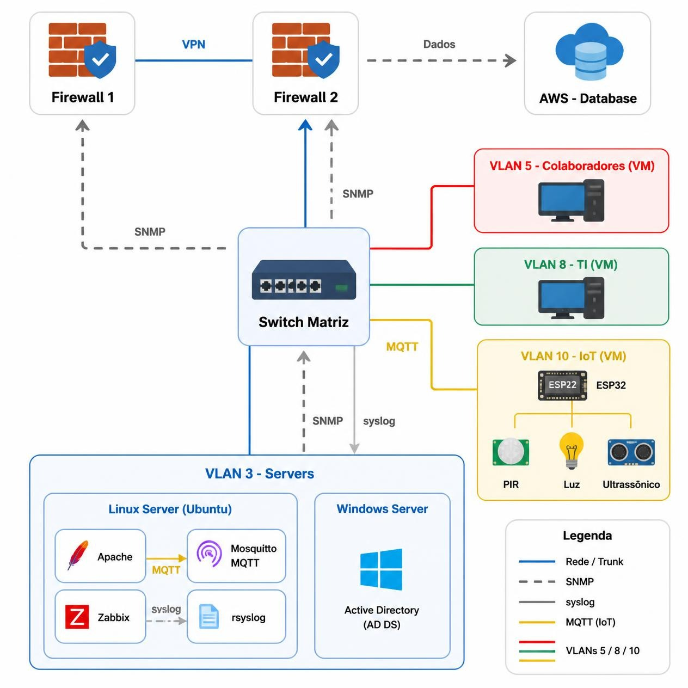

# 🌐 Projeto Rede de Dados – Tutoria 2026

> Projeto desenvolvido na Tutoria 2026, em parceria entre SENAI e CTI, com foco na simulação de um ambiente corporativo composto por matriz, filial e nuvem.

  
  
  
  
  

## 📋 Sobre o projeto

A solução integra conceitos de redes, segurança, virtualização, monitoramento e IoT.

O projeto demonstra como uma organização pode:

- Segmentar a rede em VLANs por função.
- Controlar acessos por firewalls.
- Conectar ambientes por VPNs seguras.
- Monitorar infraestrutura e dispositivos IoT.
- Centralizar logs.
- Integrar uma aplicação corporativa a uma infraestrutura de dados.

## 🗺️ Topologia

  

> Adicione o arquivo `diagrama.jpg` à pasta `imagens/`.

## 🚀 Tecnologias utilizadas

| Área | Tecnologias |
|---|---|
| 🔥 Segurança | FortiGate |
| 🌐 Redes | Cisco, VLANs, VPN IPsec, OSPF |
| 🖥️ Virtualização | VMware ESXi |
| 🪟 Servidores | Windows Server 2025 e Debian 12 |
| 📊 Monitoramento | Zabbix e Grafana |
| 📡 IoT | MQTT e Mosquitto |
| ☁️ Nuvem | AWS |

## 📊 Status do projeto

| Componente | Status |
|---|---|
| Rede da matriz | 🟢 Em funcionamento |
| Servidores | 🟢 Em funcionamento |
| Monitoramento | 🟢 Em funcionamento |
| IoT | 🟢 Em funcionamento |
| VPN Matriz–Meio | 🟡 Em configuração |
| Filial | 🟡 Em desenvolvimento |
| AWS | 🔴 Pendente |

## 📚 Documentação

| Documento | Conteúdo |
|---|---|
| 🏗️ [Arquitetura](docs/arquitetura.md) | Topologia e componentes da solução |
| 🌐 [Endereçamento](docs/enderecamento.md) | VLANs, IPs e interconexões |
| 🖥️ [Servidores](docs/servidores.md) | ESXi, VMs e serviços |
| 🔐 [Active Directory](docs/active-directory.md) | Domínio e autenticação |
| 📊 [Monitoramento](docs/monitoramento-zabbix.md) | Zabbix, triggers e dashboards |
| 📡 [IoT](docs/iot.md) | Emulador, MQTT e fluxo dos dados |
| 🔀 [Switches](docs/switches.md) | Matriz e filial |
| 🔥 [Firewalls](docs/firewalls.md) | Interfaces, políticas e regras |
| 🔗 [VPN e redundância](docs/vpn.md) | Túneis e diagnóstico |
| 🧪 [Testes](docs/testes.md) | Validações realizadas |
| 🛡️ [Segurança](docs/seguranca.md) | Controles, limitações e recomendações |
| ⚠️ [Pendências](docs/pendencias.md) | Próximas etapas |

## 👥 Contribuidores

| Jully Ferrari | Vinícius | Isabelly | Luane | Kaua Brito |
|:---:|:---:|:---:|:---:|:---:|
| Documentação | Servidor | Firewall | Firewall | Switch & IoT |

## 📄 Licença

MIT License — Projeto Rede de Dados (SENAI e CTI), 2026.
