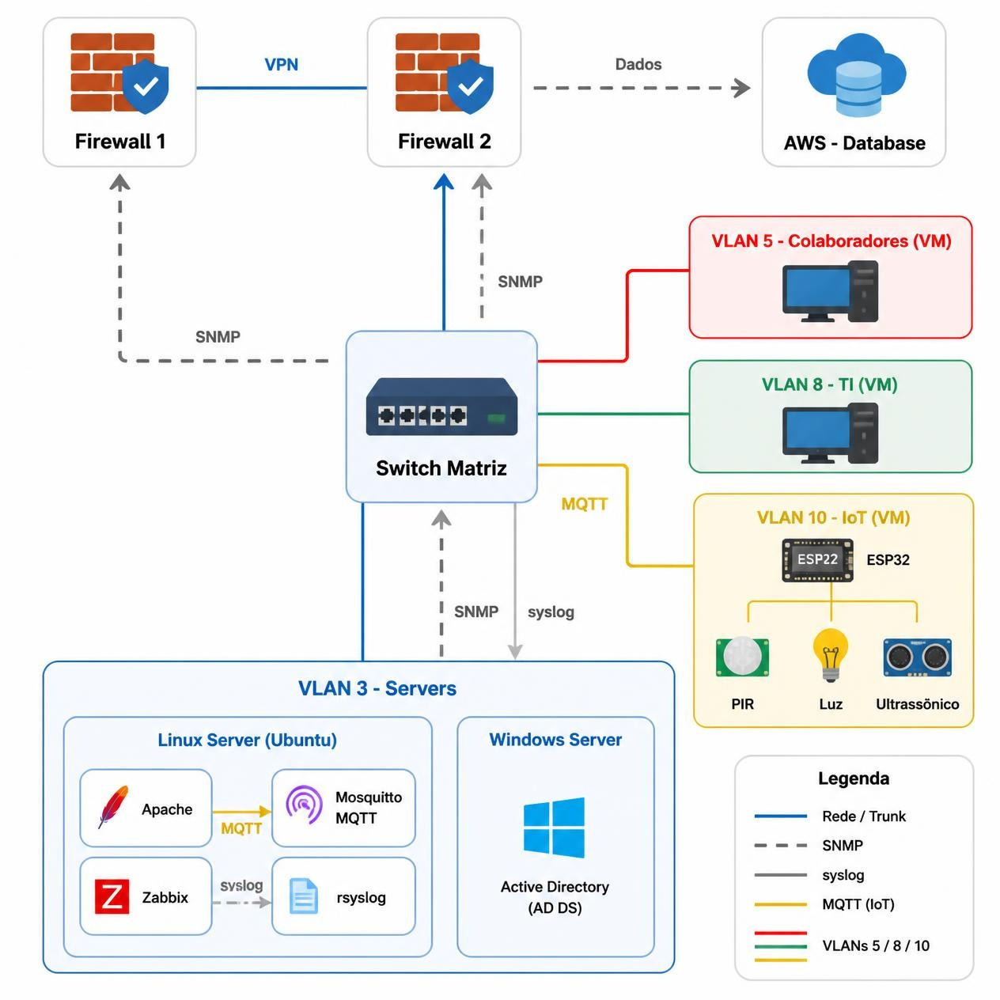

<h1>Projeto Rede de Dados – Tutoria 2026</h1>

<p align="center">
  
  
  
  
  
  
</p>

> Status do projeto: :warning: em desenvolvimento

<details open>
<summary><strong>SUMÁRIO</strong></summary>

:small_blue_diamond: [Descrição do projeto](#descrição-do-projeto)

:small_blue_diamond: [Arquitetura da solução](#arquitetura-da-solução)

:small_blue_diamond: [Endereçamento da rede](#endereçamento-da-rede)

:small_blue_diamond: [Configuração dos firewalls](#configuração-dos-firewalls)

:small_blue_diamond: [Configuração do switch da matriz](#configuração-do-switch-da-matriz)

:small_blue_diamond: [Configuração do switch da filial](#configuração-do-switch-da-filial)

:small_blue_diamond: [VPNs e redundância em anel](#vpns-e-redundância-em-anel)

:small_blue_diamond: [IoT - Câmera Emulada](#iot---câmera-emulada)

:small_blue_diamond: [Pendências](#pendências)

</details>

## Descrição do projeto

<p align="justify">
  Projeto desenvolvido na Tutoria 2026, em parceria entre SENAI e CTI, com foco em simular um ambiente corporativo completo composto por matriz, filial e nuvem. A solução foi pensada para aplicar conceitos de redes, segurança e IoT em um contexto real.
</p>

O projeto tem como objetivo demonstrar como uma organização pode:

- segmentar a rede em VLANs por função
- controlar acesso por firewalls
- conectar escritórios por VPNs seguras
- manter redundância para continuidade do serviço
- proteger o ambiente de dispositivos IoT
- integrar aplicações corporativas com banco de dados em nuvem

## Arquitetura da solução

> Topologia inicial de requisição do projeto.

<p align="center">
  
</p> 

> Diagrama do protótipo 1.2 - Matriz.

<p align="center">
  
</p>

### Componentes da topologia

| Local | Componentes | Detalhes |
| --- | --- | --- |
| Matriz | FortiGate 40F, switch (Open vSwitch), servidor de aplicação, servidor Windows, PCs de colaboradores e TI, câmera IoT | Rede principal da empresa e acesso à nuvem |
| Filial | Firewall, switch Cisco Catalyst 2960-S, PCs (3 usuários), câmera IoT | Escritório local com comunicação segura com matriz |
| Nuvem | Banco de dados em AWS/Azure | Infraestrutura centralizada para dados e serviços |

## Endereçamento da rede

### Rede matriz

| Elemento | Endereço |
| --- | --- |
| VLAN3 - Servidores | 10.0.3.0/24 |
| VLAN5 - Colaboradores | 10.0.5.0/24 |
| VLAN8 - TI | 10.0.8.0/24 |
| VLAN10 - IoT | 10.0.10.0/24 |
| Firewall da matriz | 192.168.100.10 |

### Rede filial

| Elemento | Endereço |
| --- | --- |
| VLAN10 - IoT | 10.1.10.0/24 |
| PCs | 10.1.5.0/24 |
| Firewall da filial | 192.168.100.20 |

### Interconexão e infraestrutura de suporte

| Elemento | Endereço |
| --- | --- |
| Firewall do meio | 192.168.100.1 |
| Banco de dados / VPC | 10.1.1.0/24 |

## Configuração dos firewalls

### Firewall da matriz

- Controle de acesso à internet e à nuvem
- Bloqueio de tráfego entre PCs da matriz e da filial
- Liberação das VLANs conforme a regra de segmentação
- Terminação das VPNs da nuvem e da filial
- Saída de internet da filial

| Item | Valor |
| --- | --- |
| Marca / Modelo | Fortinet FortiGate 40F |
| Sistema operacional | FortiOS 7.4.12 (build 2902) |
| VDOM | NEOXGATE |
| IP de gerência | 192.168.100.10 |
| Regras implementadas | ACLs para VLAN3, VLAN5, VLAN8, VLAN10, acesso à internet e VPN |

#### Verificação inicial (21/10/2026)

Conferência do equipamento e da conectividade pelo CLI Console.

**Interfaces**

| Interface | Função | Endereço |
| --- | --- | --- |
| lan2 | WAN (saída para a internet) | 172.16.33.35/24 |
| lan1 | LAN (rede interna) | 192.168.200.1/24 |

**DHCP (lan1):** faixa de 192.168.200.2 a 192.168.200.254.

**Rota padrão**

| Destino | Gateway | Interface de saída |
| --- | --- | --- |
| 0.0.0.0/0 | 172.16.33.254 | lan2 (WAN) |

**Testes de conectividade**

| Teste | Resultado |
| --- | --- |
| Ping para o gateway 172.16.33.254 | Sucesso |
| Ping para 8.8.8.8 | Sucesso |
| Ping para google.com | Falha na resolução de nome |

A conectividade IP com a internet está funcionando. A falha na resolução de nome indica problema de DNS, que ainda não foi confirmado: os comandos de consulta ao DNS retornaram erro no CLI e a configuração atual não pôde ser lida. A verificação será refeita na segunda-feira.

### Firewall da filial

- Controle de acesso à internet e à nuvem
- Navegação encaminhada pela matriz
- Bloqueio de tráfego entre PCs da filial e da matriz
- Terminação das VPNs da nuvem e da matriz

| Item | Valor |
| --- | --- |
| Marca / Modelo | A definir |
| IP de gerência | 192.168.100.20 |
| Regras implementadas | ACLs para VLAN10, PCs, acesso à matriz e à nuvem via VPN |

## Configuração do switch da matriz

A camada de acesso da matriz foi implementada com Open vSwitch (OVS), permitindo a criação de uma bridge lógica com segmentação por VLANs e integração com o firewall e os serviços internos.

### Topologia utilizada

| Interface | Segmento | VLAN | Função |
| --- | --- | --- | --- |
| ens37 | NAT | - | Acesso externo / internet |
| ens38 | link-fw | trunk | Uplink com o firewall |
| ens39 | vlan3-srv | 3 | Servidores |
| ens40 | vlan5-colab | 5 | Colaboradores |
| ens41 | vlan8-ti | 8 | TI |
| ens42 | vlan10-iot | 10 | IoT / Câmera emulada |

### Objetivo

O switch atua como ponto de agregação da rede corporativa, separando o tráfego por função e mantendo o ambiente controlado:

- VLAN 3: servidores
- VLAN 5: colaboradores
- VLAN 8: TI
- VLAN 10: dispositivos IoT

### Comandos utilizados

```bash
su -

apt update
apt install openvswitch-switch
ovs-vsctl add-br br0

ovs-vsctl add-port br0 ens37
ovs-vsctl add-port br0 ens38
ovs-vsctl add-port br0 ens39 tag=3
ovs-vsctl add-port br0 ens40 tag=5
ovs-vsctl add-port br0 ens41 tag=8
ovs-vsctl add-port br0 ens42 tag=10

for i in ens37 ens38 ens39 ens40 ens41 ens42; do
    ip link set $i up
done

cat > /etc/network/interfaces.d/ovs-ports << 'EOF'
auto ens37
iface ens37 inet manual

auto ens38
iface ens38 inet manual

auto ens39
iface ens39 inet manual

auto ens40
iface ens40 inet manual

auto ens41
iface ens41 inet manual

auto ens42
iface ens42 inet manual
EOF
```

### Explicação da configuração

- `ovs-vsctl add-br br0` cria a bridge lógica do switch.
- `ovs-vsctl add-port br0 ens37` adiciona a interface de acesso externo (NAT) ao switch.
- `ovs-vsctl add-port br0 ens38` adiciona o uplink para o firewall sem tag, funcionando como trunk.
- As demais interfaces foram separadas por VLAN:
  - ens39 -> VLAN 3
  - ens40 -> VLAN 5
  - ens41 -> VLAN 8
  - ens42 -> VLAN 10

Essa abordagem permite a criação de um switch virtual multilayer com isolamento lógico entre os segmentos da rede, melhorando a organização, a segurança e o controle de acesso.

### Verificação da funcionalidade

```bash
ovs-vsctl show
ip link show
ovs-vsctl list-ports br0
```

A validação pode ser feita observando se as portas físicas foram integradas ao bridge e se as VLANs foram corretamente associadas às interfaces.

## Configuração do switch da filial

O acesso da filial utiliza um switch Cisco Catalyst 2960-S. A configuração inicial já foi aplicada, mas é **provisória**: as conexões e as VLANs ainda precisam ser validadas antes de o equipamento ser considerado pronto para uso.

| Item | Valor |
| --- | --- |
| Marca / Modelo | Cisco Catalyst 2960-S |
| Hostname | SW-FILIAL-CTI |
| Acesso de gerência | Console, com usuário local `admin` |
| Status | Configuração inicial provisória |

### O que foi configurado

| Item | Configuração |
| --- | --- |
| Identificação | Hostname `SW-FILIAL-CTI` |
| Acesso privilegiado | Senha de enable definida |
| Autenticação | Usuário local `admin` e login local no console |
| Senhas | Criptografia de senhas ativada na configuração |
| Banner | Banner de acesso restrito |
| Console | Timeout de inatividade de 5 minutos |
| VLAN | VLAN 10 criada com o nome `IOT2`, ainda sem portas atribuídas |

### Portas

| Portas | Estado | Observação |
| --- | --- | --- |
| Gi1/0/1 a Gi1/0/5 | Disponíveis | Função de cada porta ainda a definir |
| Gi1/0/6 a Gi1/0/48 | Desativadas (`shutdown`) | Portas não utilizadas |
| Te1/0/1 e Te1/0/2 | Sem alteração | Portas de 10 Gb |
| Fa0 | Sem alteração | Porta de gerenciamento |

As portas não utilizadas permanecem desativadas administrativamente para reduzir a superfície de acesso à rede.

### Etapas restantes

- Definir a função de cada uma das cinco portas disponíveis
- Definir a VLAN dos computadores da filial e a separação da rede IoT
- Configurar a conexão entre o switch e o firewall da filial
- Decidir sobre o acesso remoto por SSH
- Conferir a configuração e salvá-la

## VPNs e redundância em anel

| Túnel | Origem | Destino | Finalidade | Tipo / Protocolo |
| --- | --- | --- | --- | --- |
| VPN 1 | Matriz | Nuvem | Acesso ao banco de dados | IPsec / site-to-site |
| VPN 2 | Matriz | Filial | Comunicação entre escritórios | IPsec / site-to-site |
| VPN 3 | Filial | Nuvem | Acesso ao banco de dados | IPsec / site-to-site |

### Túneis VPN

- M–F: 172.31.0.0/30
- M–N: 172.31.0.4/30
- F–N: 172.31.0.8/30

O anel interliga matriz, filial e nuvem. Caso um link falhe, a comunicação continua pelo caminho restante.

| Item | Valor |
| --- | --- |
| Protocolo de roteamento / failover | OSPF / roteamento dinâmico com redundância em anel |
| Tempo de convergência | A definir |

## IoT - Câmera Emulada

A solução de IoT utiliza uma câmera emulada executada em uma máquina virtual **Debian 12 Full CLI** (sem interface gráfica), simulando um dispositivo de vigilância corporativo.

### Especificações da câmera emulada

| Item | Valor |
| --- | --- |
| Sistema Operacional | Debian 12 Full CLI |
| Tipo de emulação | Câmera de segurança (software) |
| Localização | VLAN10 (rede IoT) |
| Protocolo de streaming | A definir (RTSP / HTTP / MJPEG) |
| Monitoramento | Logs centralizados e alertas em tempo real |
| Acesso remoto | Via interface de gerência da matriz e filial |

### Configuração na VLAN10

- A câmera emulada trafega na **VLAN10**, isolada da rede de usuários
- Comunicação segura entre câmeras da matriz e filial via túnel VPN
- Integração com sistema de monitoramento centralizado
- Geração de logs para auditoria e análise

### Instalação e ativação

```bash
# Atualizar sistema
sudo apt update && sudo apt upgrade -y

# Instalar ferramentas de emulação de câmera
sudo apt install -y ffmpeg motion vlc-plugin-base

# Configuração específica será documentada em seção separada
```

## Pendências

| Item | Responsável | Situação |
| --- | --- | --- |
| Verificar a configuração de DNS do FortiGate da matriz | Firewall | Pendente (nova tentativa na segunda-feira) |
| Definir marca/modelo do firewall da filial | Firewall | Pendente |
| Definir função das portas Gi1/0/1 a Gi1/0/5 do switch da filial | Switch & IoT | Pendente |
| Definir VLAN dos PCs da filial e separação da rede IoT | Switch & IoT | Pendente |
| Configurar o link entre o switch e o firewall da filial | Switch & IoT / Firewall | Pendente |
| Decidir sobre acesso remoto por SSH no switch da filial | Switch & IoT | Pendente |
| Conferir e salvar a configuração do switch da filial | Switch & IoT | Pendente |
| Definir protocolo de streaming da câmera emulada | Switch & IoT | Pendente |
| Definir tempo de convergência do anel | Firewall | Pendente |

## Desenvolvedores/Contribuintes :octocat:

| [<br><sub>Jully Ferrari</sub>](https://github.com/JullySzztiass) | [<br><sub>Vinícius</sub>](https://github.com/Dedenyee) | [<br><sub>Isabelly</sub>](https://github.com/isabellyyvitoria) | [<br><sub>Luane</sub>](https://github.com/gluane) | [<br><sub>Kaua Brito</sub>](https://github.com/kaua-brito) |
| :---: | :---: | :---: | :---: | :---: |
| Documentação | Servidor | Firewall | Firewall | Switch & IoT |


---

## Licença

The [MIT License]() (MIT)

Copyright :copyright: 2026 - Projeto Rede de Dados (SENAI e CTI)

> Referência: [Preparação pré-projeto](https://miro.com/app/board/uXjVHhTdmiQ=/?share_link_id=182961988823)
