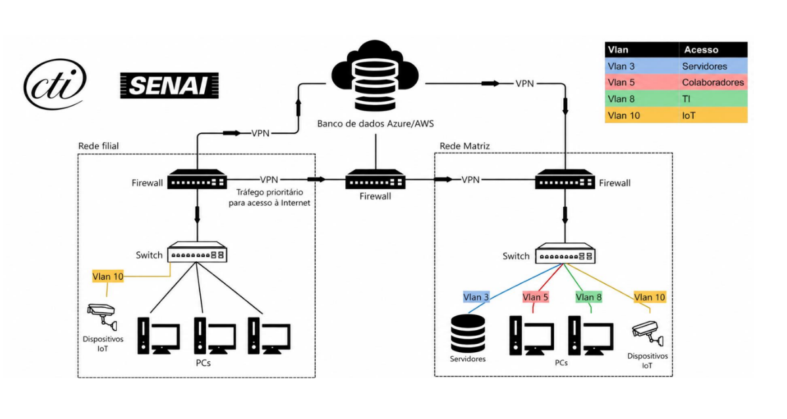
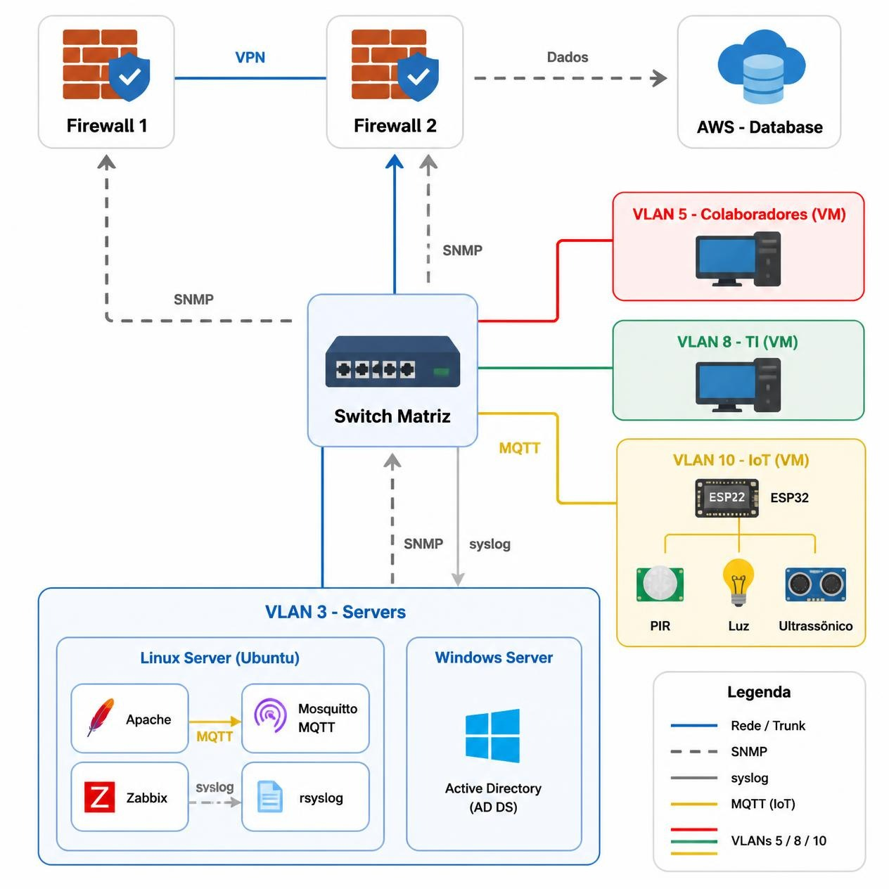

<h1 align="center">Projeto Rede de Dados</h1>

<p align="center"><strong>Tutoria 2026 · SENAI × CTI</strong></p>

<p align="center">
  
  
  
  
  
  
  
</p>

<p align="center">
  <a href="#descrição">Descrição</a> ·
  <a href="#arquitetura">Arquitetura</a> ·
  <a href="#status">Status</a> ·
  <a href="#documentação">Documentação</a> ·
  <a href="#desenvolvedorescontribuintes-octocat">Equipe</a>
</p>

> :warning: Projeto em desenvolvimento. Documentação atualizada em 24/11/2026, com base nos registros de 10/11/2026.

## Descrição

Projeto final do curso do SENAI, desenvolvido em parceria com a CTI. Simula um ambiente corporativo completo, com matriz, filial e nuvem, aplicando conceitos de redes, segurança, monitoramento e IoT em um contexto real.

A solução demonstra como uma organização pode:

- segmentar a rede em VLANs por função
- controlar o acesso por firewalls
- conectar escritórios por VPNs seguras, com redundância em anel
- isolar e monitorar dispositivos IoT, com alertas de acesso indevido
- integrar uma aplicação de cadastro de clientes com banco de dados em nuvem
- centralizar logs e monitoramento

## Arquitetura

<p align="center">
  
  <br><sub>Topologia solicitada pela CTI</sub>
</p>

<p align="center">
  
  <br><sub>Diagrama do protótipo 1.2 · Matriz</sub>
</p>

| VLAN | Uso | Faixa |
|------|-----|-------|
| 3 | Servidores | 10.0.3.0/24 |
| 5 | Colaboradores | 10.0.5.0/24 |
| 8 | TI | 10.0.8.0/24 |
| 10 | IoT | 10.0.10.0/24 |

Componentes, endereçamento completo e túneis em [docs/02-arquitetura.md](docs/02-arquitetura.md).

## Status

Detalhe por requisito em [docs/01-requisitos.md](docs/01-requisitos.md).

| Frente | Situação |
|--------|----------|
| Servidores da matriz (ESXi, Active Directory, servidor Linux) | :white_check_mark: Concluído |
| Monitoramento (Zabbix, syslog) e IoT emulado | :white_check_mark: Concluído na matriz |
| Aplicação de cadastro com controle de acesso por VLAN | :white_check_mark: Funcionando, com banco local |
| Switch da matriz | :white_check_mark: Concluído |
| Switch da filial | :construction: Configuração inicial provisória |
| Firewall e VPN matriz–meio–filial | :construction: Túnel matriz–meio ainda não estabeleceu |
| Banco na nuvem, anel de VPN, filial completa, acesso remoto com dupla autenticação | :hourglass_flowing_sand: Pendente |

## Documentação

| # | Documento | Conteúdo |
|---|-----------|----------|
| 01 | [Requisitos e status](docs/01-requisitos.md) | O que a CTI/SENAI pediu e onde cada item está |
| 02 | [Arquitetura e endereçamento](docs/02-arquitetura.md) | Componentes, VLANs, IPs, hosts e túneis |
| 03 | [Servidores](docs/03-servidores.md) | ESXi, Active Directory, servidor Linux e aplicação |
| 04 | [Monitoramento e IoT](docs/04-monitoramento-iot.md) | Zabbix, syslog, MQTT e dispositivo IoT emulado |
| 05 | [Switches](docs/05-switches.md) | Switch da matriz e da filial |
| 06 | [Firewalls](docs/06-firewalls.md) | Matriz, meio e filial, com as políticas de acesso |
| 07 | [VPN e anel](docs/07-vpn.md) | Túneis, redundância, estado atual e diferenças em relação à produção |
| 08 | [Diagnóstico da VPN e da filial](docs/08-vpn-diagnostico.md) | Investigação do túnel matriz–meio, acesso à filial e comandos de verificação |
| 09 | [Segurança](docs/09-seguranca.md) | Controles aplicados, limitações e checklist de entrega |
| 10 | [Pendências](docs/10-pendencias.md) | O que falta, por frente de trabalho |

## Estrutura do repositório

```
├── README.md
├── LICENSE
├── docs/        documentação por tema (01 a 10)
├── configs/     configurações dos firewalls, sem senhas
├── scripts/     scripts do projeto (emulador IoT, dashboards do Zabbix)
└── imagens/     diagramas e evidências
```

> Nenhuma senha, token ou `show running-config` deve ser versionado neste repositório.

## Desenvolvedores/Contribuintes :octocat:

| [<br><sub>Jully Ferrari</sub>](https://github.com/JullySzztiass) | [<br><sub>Vinícius</sub>](https://github.com/Dedenyee) | [<br><sub>Isabelly</sub>](https://github.com/isabellyyvitoria) | [<br><sub>Luane</sub>](https://github.com/gluane) | [<br><sub>Kaua Brito</sub>](https://github.com/kaua-brito) |
| :---: | :---: | :---: | :---: | :---: |
| Documentação | Servidor | Firewall | Firewall | Switch & IoT |

---

## Licença

Distribuído sob a [licença MIT](LICENSE).

Copyright :copyright: 2026 · Projeto Rede de Dados (SENAI e CTI)

> Referência: [Preparação pré-projeto](https://miro.com/app/board/uXjVHhTdmiQ=/?share_link_id=182961988823)
