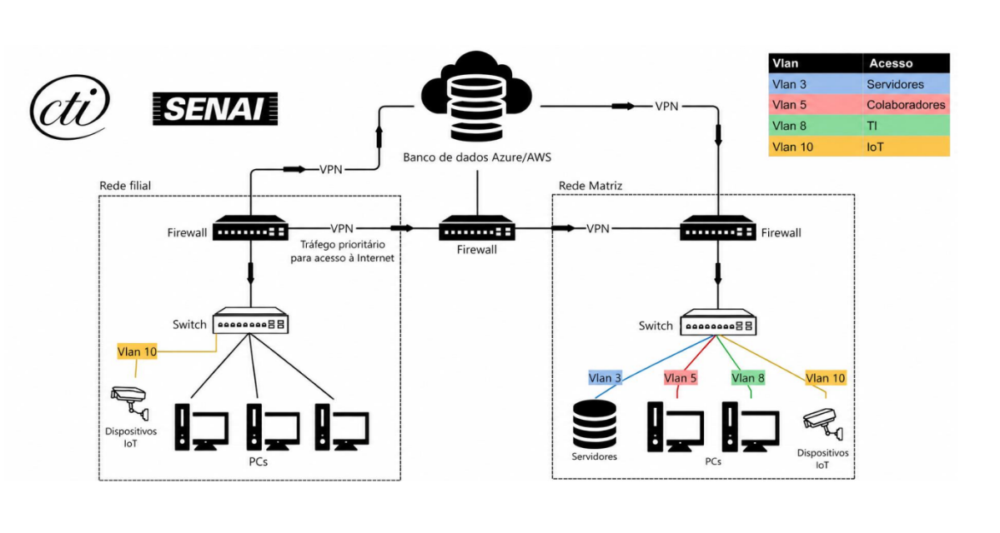
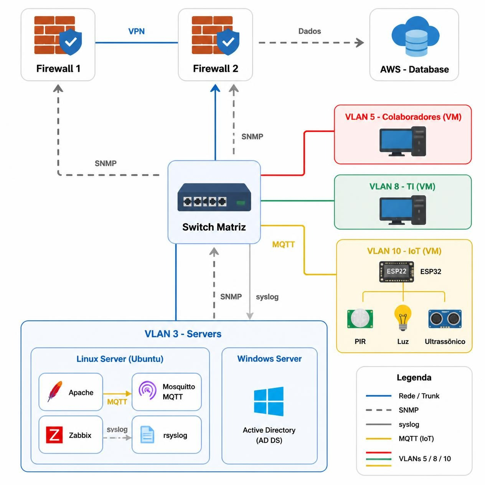
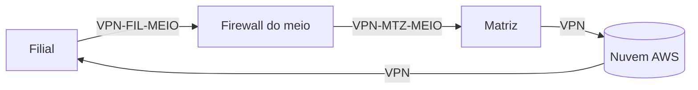

# Arquitetura e endereçamento

Concentra todos os endereços do projeto. Os demais documentos apontam para esta página em vez de repeti-los.

## Topologia

  
   Topologia solicitada pela CTI

  
   Diagrama do protótipo 1.2 · Matriz

O diagrama do projeto não pode ser alterado. Ele prevê um firewall em cada escritório e um firewall do meio, ligados por VPN, com o banco de dados em nuvem fechando o anel.

### Componentes

| Local | Componentes | Função |
|-------|-------------|--------|
| Matriz | FortiGate 40F, switch Cisco WS-C2960S-24TD-L, servidor Dell PowerEdge T440 com ESXi (Active Directory, servidor Linux e dispositivo IoT emulado), PCs de colaboradores e TI | Rede principal da empresa e acesso à nuvem |
| Meio | FortiGate-VM | Intermedeia os túneis entre matriz e filial |
| Filial | Firewall, switch Cisco Catalyst 2960-S, PCs, dispositivo IoT | Escritório de vendas para 5 pessoas, com comunicação segura com a matriz |
| Nuvem | Banco de dados em AWS (VPC) | Infraestrutura centralizada para dados |

## Endereçamento

### Redes internas

| Local | VLAN | Uso | Faixa |
|-------|------|-----|-------|
| Matriz | 3 | Servidores | 10.0.3.0/24 (gateway 10.0.3.1 no firewall) |
| Matriz | 5 | Colaboradores | 10.0.5.0/24 |
| Matriz | 8 | TI | 10.0.8.0/24 |
| Matriz | 10 | IoT | 10.0.10.0/24 (gateway 10.0.10.1 no firewall) |
| Filial | — | PCs | 10.1.5.0/24 |
| Filial | 10 | IoT | 10.1.10.0/24 |
| Nuvem | — | VPC do banco de dados | 10.1.1.0/24 |

### Firewalls

| Firewall | IP de gerência (projeto) | Interfaces configuradas |
|----------|--------------------------|-------------------------|
| Matriz | 192.168.100.10 | `lan1` 192.168.200.10/24 · `lan2` (WAN) 172.16.31.30/24 por DHCP |
| Meio | 192.168.100.1 | `port1` (WAN) 172.16.31.43/24 por DHCP |
| Filial | 192.168.100.20 | `lan1` 192.168.200.1/24, secundário 10.1.5.1/24 · `lan2` (WAN) sem IP |

Detalhes de cada firewall em [06-firewalls.md](06-firewalls.md).

### Túneis VPN

| Túnel | Faixa | Pontas |
|-------|-------|--------|
| Filial ↔ Meio (`VPN-FIL-MEIO`) | 172.31.0.0/30 | meio .1, filial .2 |
| Meio ↔ Matriz (`VPN-MTZ-MEIO`) | 172.31.0.12/30 | meio .13, matriz .14 |
| Matriz ↔ Nuvem | 169.254.10.0/30 e 169.254.10.4/30 | definidas pela AWS |
| Filial ↔ Nuvem | 169.254.11.0/30 e 169.254.11.4/30 | definidas pela AWS |

A faixa 172.31.0.12/30 foi proposta porque a tabela original previa uma só faixa para o trecho matriz–filial e agora são dois túneis; ela depende da aprovação do grupo. As faixas 169.254.x.x vêm do desenho original, por causa da AWS.

### Rede do laboratório

| Item | Endereço | Observação |
|------|----------|------------|
| WAN de matriz e meio | 172.16.31.0/24 | DHCP da rede do laboratório |
| ESXi (gerência) | 172.16.31.38 | Rede física da escola |
| iDRAC do servidor | 172.16.9.4 | Rede física da escola |

### Hosts da matriz

| Máquina | IP | VLAN | Função |
|---------|-----|------|--------|
| SRV-WIN | 10.0.3.10 | 3 | Active Directory e DNS do domínio `ad.neoxgate.lab` |
| SRV-LINUX | 10.0.3.20 | 3 | Aplicação, banco, MQTT, syslog e Zabbix |
| iot-matriz | 10.0.10.10 | 10 | Dispositivo IoT emulado |

O DNS dos usuários para `neoxgate.lab` fica no Kali; o AD responde apenas pela zona `ad.neoxgate.lab`.
