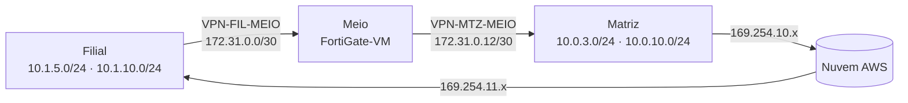

# VPN e redundância em anel

Endereços das faixas em [02-arquitetura.md](02-arquitetura.md). Configurações em [`configs/`](../configs/). Investigação do túnel matriz–meio em [08-vpn-diagnostico.md](08-vpn-diagnostico.md).

## Desenho

O diagrama do projeto prevê duas VPNs, da filial e da matriz, passando pelo firewall do meio. O túnel direto matriz–filial montado no início foi substituído por dois túneis; objetos, políticas e o isolamento dos PCs continuam valendo. O anel fecha em filial → meio → matriz → nuvem → filial.

| Túnel | Origem | Destino | Finalidade |
|-------|--------|---------|------------|
| `VPN-FIL-MEIO` | Filial (`lan2`) | Meio (`port1`) | Comunicação entre escritórios |
| `VPN-MTZ-MEIO` | Matriz (`lan2`) | Meio (`port1`) | Comunicação entre escritórios |
| Matriz ↔ Nuvem | Matriz | AWS | Acesso ao banco de dados |
| Filial ↔ Nuvem | Filial | AWS | Acesso ao banco de dados |

Todos são IPsec site-to-site (IKEv2). Matriz e filial só se alcançam pelo meio, e a nuvem fecha o anel: se um link falhar, a comunicação segue pelo caminho restante.

| Item | Valor |
|------|-------|
| Protocolo de roteamento e failover | OSPF, com roteamento dinâmico e redundância em anel |
| Tempo de convergência | A definir |

**Isolamento.** As políticas liberam apenas servidores e IoT entre as pontas; nenhuma liga os PCs da matriz aos PCs da filial.

## Estado em 10/11/2026

| Item | Estado | O que falta |
|------|--------|-------------|
| Rede matriz ↔ meio (172.16.31.0/24) | Ping responde nos dois sentidos | Nada |
| `VPN-MTZ-MEIO` | Matriz em `connecting`; o meio recebe o `IKE_SA_INIT` e o descarta com `no policy configured` | Aplicar a interface do túnel e as políticas no meio e testar |
| Proposal IKE e IPsec | `des-sha256`, DH 14, nos dois lados | Em produção, voltar a `aes256-sha256` |
| Syslog 514 UDP/TCP (IoT → servidor) | Liberado na política 13 da matriz e validado | Nada |
| Filial | `lan1` up em 192.168.200.1/24; `lan2` down, sem IP; o Kali não resolve ARP da `lan1` | Link e IP da `lan2`, depois o túnel `VPN-FIL-MEIO` |
| Túneis com a nuvem (AWS) | Faixas definidas no desenho original | Sem configuração registrada |

## WAN da filial

A `lan2` está sem link e sem IP, e o grupo informou que ela não vai pegar IP por DHCP. O túnel `VPN-FIL-MEIO` depende de uma destas alternativas:

| Opção | Como | Condição |
|-------|------|----------|
| IP fixo na 172.16.31.0/24 | `set mode static`, `set ip 172.16.31.<LIVRE> 255.255.255.0`, `set allowaccess ping` | A CTI confirmar um IP livre |
| Liberar o MAC no DHCP | Pedir à CTI para liberar o MAC da `lan2` da filial | Rede do SENAI/CTI filtrar por MAC |
| Cabo direto filial ↔ meio | `port2` do meio 172.16.40.1/30 e `lan2` da filial 172.16.40.2/30, usados como `remote-gw` | O diagrama do projeto permitir esse cabo |

O modelo de configuração da filial está em [`configs/fortigate-filial-modelo.txt`](../configs/fortigate-filial-modelo.txt). O phase2 segue o da matriz, trocando o nome, e as rotas da filial vão para 10.0.3.0/24 e 10.0.10.0/24 pelo túnel. O `remote-gw` e a interface mudam se a opção do cabo direto for escolhida.

## Diferenças entre laboratório e produção

Pontos que precisam constar no relatório e na apresentação à banca.

| Ponto | Laboratório | Produção |
|-------|-------------|----------|
| Criptografia | `des-sha256` com DH 14: o FortiGate-VM do meio só oferece DES e NULL (causa provável: licença de avaliação, não confirmada com `get system status`) | `aes256-sha256` com DH 14, como na primeira versão da matriz, com a mesma topologia e as mesmas políticas |
| IPs dos túneis | `remote-gw` fixo apontando para IPs entregues por DHCP (172.16.31.30 e 172.16.31.43); se mudarem, o túnel cai | Reserva de DHCP pela CTI ou IP fixo |
| Isolamento | Nenhuma política liga os PCs da matriz aos da filial. Dentro da matriz, o IoT 10.0.10.10 alcança apenas o servidor 10.0.3.20, só em PING, MQTT (1883/TCP) e syslog (514 UDP/TCP) | Igual |

**Persistência no FortiGate.** Cada bloco `set … next … end` já grava na configuração em execução, que sobrevive a reinício; não existe "salvar". Faça backup (Configuration > Backup) antes de mudanças grandes e anexe ao relatório. Reverter um snapshot da VM desfaz o que foi feito depois dele.
