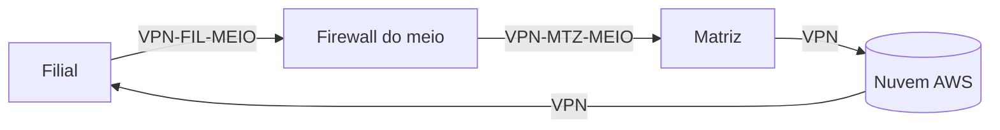
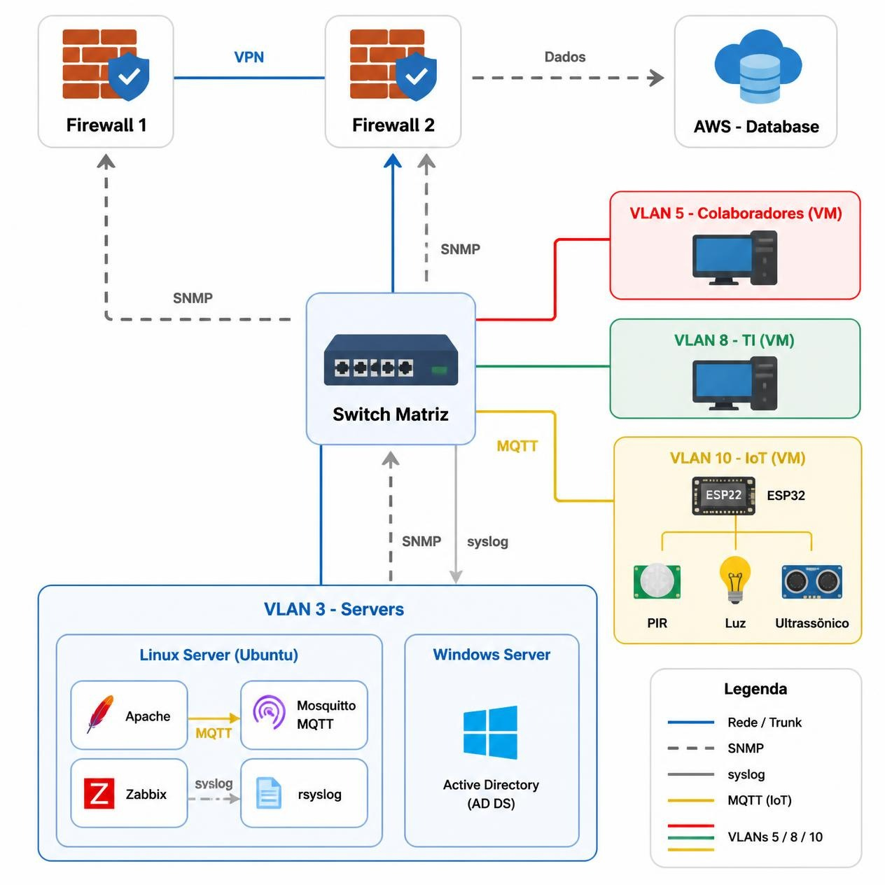

# Arquitetura e endereçamento

Concentra todos os endereços do projeto. Os demais documentos apontam para esta página em vez de repeti-los.

## Topologia

O diagrama do projeto (CTI/SENAI) não pode ser alterado. Ele prevê um firewall em cada escritório e um firewall do meio, ligados por VPN, com o banco de dados em nuvem fechando o anel.

## Endereçamento

### Redes internas

| Local | VLAN | Uso | Faixa |
|-------|------|-----|-------|
| Matriz | 3 | Servidores | 10.0.3.0/24 (gateway 10.0.3.1 no firewall) |
| Matriz | 5 | Colaboradores | 10.0.5.0/24 |
| Matriz | 8 | TI | 10.0.8.0/24 |
| Matriz | 10 | IoT | 10.0.10.0/24 (gateway 10.0.10.1 no firewall) |
| Filial | — | PCs | 10.1.5.0/24 |
| Filial | 10 | IoT | 10.1.10.0/24 |
| Nuvem | — | VPC do banco de dados | 10.1.1.0/24 |

### Túneis VPN

| Túnel | Faixa | Pontas |
|-------|-------|--------|
| Filial ↔ Meio (`VPN-FIL-MEIO`) | 172.31.0.0/30 | meio .1, filial .2 |
| Meio ↔ Matriz (`VPN-MTZ-MEIO`) | 172.31.0.12/30 (proposta, aguarda aprovação do grupo) | meio .13, matriz .14 |
| Matriz ↔ Nuvem | 169.254.10.0/30 e 169.254.10.4/30 | definidas pela AWS |
| Filial ↔ Nuvem | 169.254.11.0/30 e 169.254.11.4/30 | definidas pela AWS |

### Rede do laboratório

| Item | Endereço | Observação |
|------|----------|------------|
| Rede de laboratório (WAN de matriz e meio) | 172.16.31.0/24 | DHCP |
| Firewall da matriz, `lan2` | 172.16.31.30 | |
| Firewall do meio, `port1` | 172.16.31.43 | |
| Firewall da matriz, `lan1` | 192.168.200.10/24 | |
| Firewall da filial, `lan1` | 192.168.200.1/24, secundário 10.1.5.1/24 | `lan2` (WAN) sem link |
| ESXi (gerência) | 172.16.31.38 | rede física da escola |
| iDRAC do servidor | 172.16.9.4 | rede física da escola |

## Hosts da matriz

| Máquina | IP | VLAN | Função |
|---------|-----|------|--------|
| SRV-WIN | 10.0.3.10 | 3 | Active Directory e DNS do domínio `ad.neoxgate.lab` |
| SRV-LINUX | 10.0.3.20 | 3 | Aplicação, banco, MQTT, syslog e Zabbix |
| iot-matriz | 10.0.10.10 | 10 | Dispositivo IoT emulado |

O DNS dos usuários para `neoxgate.lab` fica no Kali; o AD responde apenas pela zona `ad.neoxgate.lab`.
