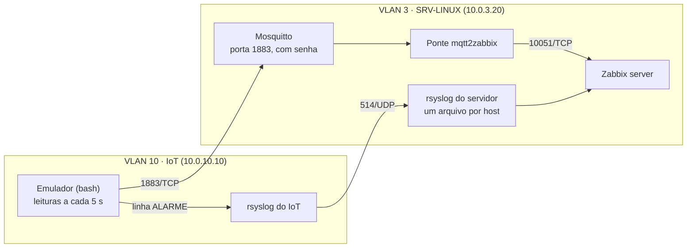

# Monitoramento e IoT

O Zabbix 7.0 monitora o dispositivo IoT emulado e os serviços do `SRV-LINUX`, abrindo um alerta quando um sensor dispara ou um serviço cai. Os logs são centralizados por syslog.

## Dispositivo IoT emulado

Um script bash (`/opt/iot/emulador.sh`) roda na VLAN 10 (`iot-matriz`, 10.0.10.10) e envia por MQTT, a cada 5 segundos, as leituras de movimento (`pir`), luz (`ldr`) e distância (`dist`). Se houver movimento, luz acima de 2000 ou presença a menos de 30 cm, o campo `alarme` sobe para 1. A senha do MQTT é pedida na hora, sem ficar gravada.

O script aceita quatro cenários para teste:

| Cenário | Efeito |
|---------|--------|
| `normal` | Tudo em repouso, `alarme` igual a 0 |
| `movimento` | `pir` igual a 1 e `alarme` igual a 1 |
| `luz` | `ldr` alto e `alarme` igual a 1 |
| `presenca` | Distância abaixo de 30 cm e `alarme` igual a 1 |

## Fluxo dos dados

O emulador nunca fala direto com o Zabbix. O dado segue dois caminhos independentes até o servidor:

**MQTT.** O Mosquitto tem dois usuários com permissões separadas: `iot_sensor`, que só publica em `sensores/#`, e `zbx_bridge`, que só lê esse tópico. As mensagens usam o tópico `sensores/<local>/leitura` com um JSON de `local`, `pir`, `ldr`, `dist` e `alarme`.

**Syslog.** Um arquivo por equipamento e programa em `/var/log/remoto/<host>/<programa>.log`, com rotação diária de 14 arquivos compactados.

## Zabbix

O nome do host `Zabbix server` é o mesmo Hostname do agente, porque os itens de log (agente ativo) só funcionam quando os dois coincidem.

| Host | Itens |
|------|-------|
| `IOT-MATRIZ` (grupo IoT) | Quatro itens trapper: `sensor.pir`, `sensor.ldr`, `sensor.dist` e `sensor.alarme` |
| `Zabbix server` (o próprio SRV-LINUX) | Portas 514/UDP, 1883/TCP e 80/TCP, o processo da ponte e quatro itens de log: alarmes do IoT, 403 do Apache, erros do Apache e falhas de login SSH |

### Alertas (triggers)

| Trigger | Host | Gravidade | Condição |
|---------|------|-----------|----------|
| Alarme ativo | IOT-MATRIZ | Average | `sensor.alarme` igual a 1 |
| Movimento fora do expediente | IOT-MATRIZ | High | PIR igual a 1 antes das 8h ou depois das 18h |
| Presença próxima fora do expediente | IOT-MATRIZ | High | Distância menor que 30 cm fora do expediente |
| Luz acesa fora do expediente | IOT-MATRIZ | High | LDR maior que 2000 fora do expediente |
| Sensor sem dados | IOT-MATRIZ | High | Nenhum valor de PIR em 2 minutos |
| Syslog, Mosquitto, Apache ou ponte parados | Zabbix server | High | Porta ou processo igual a 0 |

### Dashboards

Criados pela API do Zabbix com um script que pode ser executado de novo:

- **IoT - Matriz:** alarme e PIR (vermelhos quando valem 1), medidores de luz e distância, disponibilidade, problemas do grupo IoT e o último alarme vindo do syslog.
- **Infraestrutura:** estado do syslog, do Mosquitto e do Apache, relógio, informações do Zabbix, problemas, acessos bloqueados (403) e falhas de SSH.

## Testes realizados

| Teste | Evidência |
|-------|-----------|
| Mosquitto recusa acesso anônimo | `Connection Refused: not authorised` a partir do IoT, pela VLAN 10 |
| Sensores até o Zabbix | Último valor no Zabbix com 3 segundos de atraso em relação ao servidor |
| Alarme no Zabbix | Cenário `movimento` coloca PIR e alarme em 1 e abre o problema "Alarme ativo"; `normal` resolve |
| Gateway da VLAN 10 | `ping 10.0.10.1` responde em cerca de 0,2 ms |
| Syslog do IoT no servidor | Linhas do IoT chegam ao SRV-LINUX depois da liberação da 514/UDP |

As regras de firewall que sustentam esse fluxo (política 13) estão em [rede-firewall-vpn.md](rede-firewall-vpn.md#políticas-do-firewall-da-matriz).
